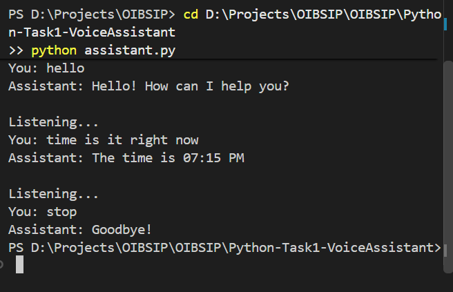

# Voice Assistant (Beginner)

Python voice assistant. It listens to spoken commands and replies out loud.

## Features
- Voice input from microphone (speech_recognition)
- Replies with text-to-speech (pyttsx3)
- Say "hello" for a greeting
- Ask the time or the date
- Say "search <topic>" to open a Google search in the browser
- If speech is not understood, it asks you to repeat
- Say "stop", "exit" or "bye" to quit

## Tech
Python 3, SpeechRecognition, pyttsx3, PyAudio, datetime, webbrowser

## Install
`pip install -r requirements.txt`

## Run
`python assistant.py`

## Privacy
Audio from the microphone is sent to the Google Web Speech API to convert it into text. Nothing is saved to disk by this program.

## Screenshot
