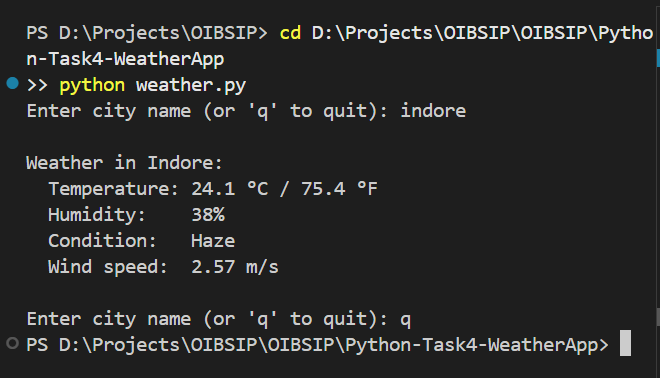

# Weather App (Beginner)

Command-line app that shows live weather for any city using the OpenWeatherMap API.

## Features
- Enter a city name
- Shows temperature in °C and °F, humidity, condition and wind speed
- Handles errors: city not found, invalid API key, timeout, no internet
- Rejects empty input

## Tech
Python 3, requests, python-dotenv, OpenWeatherMap API

## Setup
1. Get a free API key at openweathermap.org
2. Install: `pip install requests python-dotenv`
3. Create a file named `.env` in this folder with one line: `OWM_API_KEY=your_key_here`

## Run
`python weather.py`

## Screenshot
