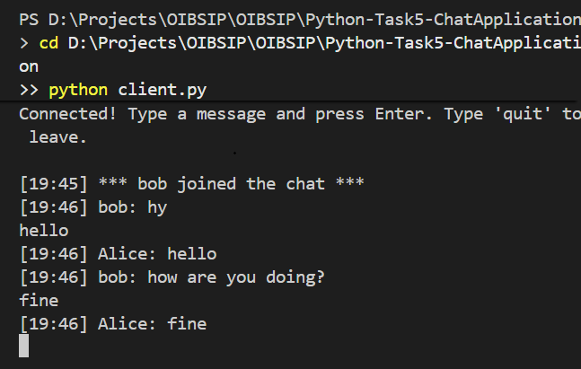

# Chat Application (Beginner)

Real-time chat using Python sockets and threading, running on localhost.

## Features
- Server accepts multiple clients
- Real-time two-way messages with timestamps, e.g. `[14:35] Alice: Hello`
- Join and leave notifications
- Graceful disconnect handling

## Tech
Python 3, socket, threading, datetime

## Run
1. Start the server: `python server.py`
2. Open two more terminals and run `python client.py` in each
3. Enter a name and chat. Type `quit` to leave.

## Screenshot
